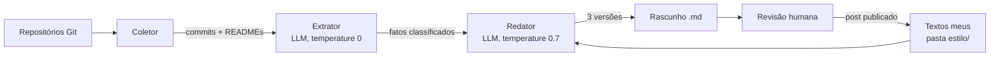

# linkedin-autopost

Pipeline local que lê o que eu desenvolvi na semana e gera rascunhos de posts para o LinkedIn, usando modelos de linguagem rodando no meu próprio servidor via [Ollama](https://ollama.com).

A publicação continua sendo manual. O sistema entrega rascunhos; a revisão e a decisão final são minhas.

## Por que este projeto existe

Eu estudo IA e programo toda semana, mas raramente transformo isso em conteúdo. Escrever um post exige parar, relembrar o que foi feito e organizar as ideias. Este projeto automatiza a parte mecânica (levantar o que mudou e montar uma primeira versão) e deixa comigo a parte que importa: revisar, corrigir e dar minha voz ao texto.

## Como funciona



O pipeline tem quatro etapas, cada uma num módulo próprio:

**1. Coletor** (`coletor.py`). Encontra os repositórios Git no diretório de projetos, lê os commits dos últimos 7 dias com `git log` e identifica os arquivos alterados em cada commit. Dos READMEs modificados, extrai apenas as linhas adicionadas na semana, via `git diff`. Tudo é montado num único material, com os commits em ordem cronológica.

**2. Extrator** (`extrator.py`). Um LLM lê o material e devolve os fatos relevantes para um post, cada um classificado como `construcao`, `descoberta`, `problema` ou `proximo_passo`. A saída é forçada num JSON Schema, e a temperatura é zero, porque aqui o objetivo é fidelidade ao texto, e não criatividade.

**3. Redator** (`redator.py`). Um segundo prompt transforma os fatos em três versões de post, cada uma com um ângulo diferente: a jornada de construção, a descoberta mais surpreendente e as limitações encontradas. Textos escritos por mim entram no prompt como exemplos de estilo.

**4. Saída** (`saida.py`). Salva `rascunhos/AAAA-MM-DD.md` com as três versões e, no final, a lista dos fatos que as originaram, para conferência.

## Decisões de design

**Histórico do Git em vez de varrer diretórios.** Olhar arquivos soltos diz pouco sobre o que mudou. Commits, arquivos alterados e mensagens contam o que foi feito na semana.

**Duas etapas de IA em vez de um prompt só.** Separar extração e redação dá a cada etapa uma tarefa simples e permite inspecionar os fatos antes de virarem texto. Quando um post sai ruim, dá para saber se o problema foi no que o modelo entendeu ou no que ele escreveu.

**Saída estruturada com `enum`.** Sem o esquema, o modelo responderia com texto livre, e cada rodada inventaria um nome de categoria diferente. O `enum` garante que o tipo seja sempre um dos quatro valores esperados.

**Commits como fonte mais atual.** Num dos testes, o README dizia que integrar o pgvector era um próximo passo, mas um commit posterior já tinha feito isso. O modelo acreditou no README. A solução foi listar os commits em ordem cronológica, com os arquivos de cada um, e instruir o modelo a tratar os commits como a fonte mais recente.

**Um modelo por etapa.** A extração começou com `qwen2.5:14b`, mas, conforme as regras cresceram (cronologia, desempate entre categorias, preservação de detalhes), o modelo passou a cumprir umas e largar outras. O `qwen3.8:27b`, com o mesmo prompt, seguiu todas. Os modelos ficam separados no `config.py`, então dá para trocar uma etapa sem mexer na outra.

**Ângulos em vez de repetições.** Gerar três vezes o mesmo pedido produzia três posts iguais, com aberturas diferentes. Pedir três ângulos, com no máximo três fatos cada, muda a seleção do conteúdo, e não só a superfície.

**Os fatos no rodapé do rascunho.** A revisão fica muito mais rápida quando cada afirmação do post pode ser conferida contra a lista de fatos, sem rodar nada de novo.

**Estilo por exemplos, e não por fine-tuning.** Em vez de treinar um modelo, a pasta `estilo/` guarda textos meus, e os mais recentes entram no prompt. Cada post publicado, já revisado, vira um novo exemplo. Com o tempo, essa pasta se torna um dataset limpo para um eventual fine-tuning.

**Humano no circuito.** Automatizar a publicação no LinkedIn esbarra nos termos de uso da plataforma e, principalmente, na qualidade: um post com um resultado inventado no meu perfil é pior do que não postar.

**Só o que mudou na semana.** Na primeira versão, o coletor lia os READMEs alterados inteiros. Como meus READMEs acumulam a história de todos os módulos, descobertas de semanas atrás voltavam como fatos novos. Agora o coletor compara o estado do README antes do primeiro commit da semana com o estado atual e envia ao modelo só as linhas adicionadas.

## O que aprendi construindo

**O redator extrapola de forma plausível.** Mesmo com a instrução "use apenas os fatos fornecidos", o modelo às vezes afirmava coisas que eu não fiz, como ter "resolvido" um problema que eu só tinha descoberto. É exatamente o comportamento que documentei no meu [estudo de RAG](https://github.com/DiegoOCruz/estudos-ia), agora aparecendo no meu próprio pipeline. Por isso a revisão humana é parte do projeto, e não um detalhe.

**Fidelidade e fluidez puxam para lados opostos.** Com regras frouxas, o modelo inventava ganchos e exageros. Com regras rígidas ("mantenha os detalhes exatamente como estão"), ele passava a copiar os fatos e o post ficava com cara de relatório. O equilíbrio veio de pedir fidelidade aos fatos e liberdade na redação, e de mostrar exemplos reais de como eu escrevo.

**Modelos de linguagem não contam caracteres.** Um limite de 2000 caracteres gerou posts de quase 3000. Limites em palavras funcionam melhor, e a medição final é feita no código.

**Ajustar prompt tem retorno decrescente.** A partir de certo ponto, cada rodada trocava uns erros por outros. Gerar variações e revisar com um critério claro rendeu mais do que continuar refinando instruções.

**O modelo pode acabar imitando a si mesmo.** Salvei por engano um rascunho gerado, sem edição, na pasta de exemplos de estilo. Nas semanas seguintes, o redator passou a copiar parágrafos inteiros dele. Isso aparecia como um post idêntico, palavra por palavra, em semanas diferentes, algo improvável com temperatura 0.7. Duas mudanças resolveram: só entra em `estilo/` o texto que eu publiquei depois de editar, e cada exemplo vai no prompt entre tags `<exemplo>`, com a instrução de imitar como eu escrevo, e não sobre o que escrevo.

## Estrutura

```
linkedin-autopost/
├── config.py      # caminhos, modelos, ângulos e limites
├── coletor.py     # repositórios, commits, arquivos e READMEs
├── extrator.py    # entidade Fato e extração via LLM
├── redator.py     # prompt de redação e exemplos de estilo
├── saida.py       # gravação do rascunho
├── main.py        # orquestra as etapas
├── estilo/        # textos meus usados como exemplo (fora do Git)
└── rascunhos/     # rascunhos gerados (fora do Git)
```

## Como rodar

**Requisitos:** Python 3.10+, Git e Ollama com um modelo de texto instalado.

```bash
python -m venv .venv
source .venv/bin/activate
pip install ollama

ollama pull qwen3.8:27b
```

Ajuste o `config.py`: o diretório onde ficam seus repositórios (`DIRETORIO_PROJETOS`) e os modelos de cada etapa. Opcionalmente, coloque alguns textos seus em `estilo/`, como arquivos `.md`.

```bash
python main.py
```

O rascunho é salvo em `rascunhos/`, com a data do dia no nome.

Para rodar toda segunda às 7h, basta uma linha no `crontab -e` com os caminhos absolutos:

```
0 7 * * 1 /caminho/do/venv/bin/python /caminho/do/projeto/main.py >> /caminho/do/projeto/logs/cron.log 2>&1
```

## Privacidade

Todos os modelos rodam localmente, e nenhum código ou texto sai do servidor. As pastas `estilo/` e `rascunhos/` estão no `.gitignore`, porque contêm textos pessoais e posts ainda não revisados.

## Próximos passos

- **Avaliação sistemática:** um conjunto de fatos esperados para semanas de referência e uma métrica de quantos a extração encontra, para comparar prompts e modelos com números em vez de impressões.
- **Filtro de privacidade:** uma lista de repositórios e arquivos permitidos, aplicada antes de qualquer conteúdo chegar ao modelo.
- **Leitura via API do GitHub,** para incluir projetos que não estão clonados no servidor.
- **Comparar few-shot e fine-tuning com LoRA** para imitação de estilo, usando os posts acumulados em `estilo/` como dataset.